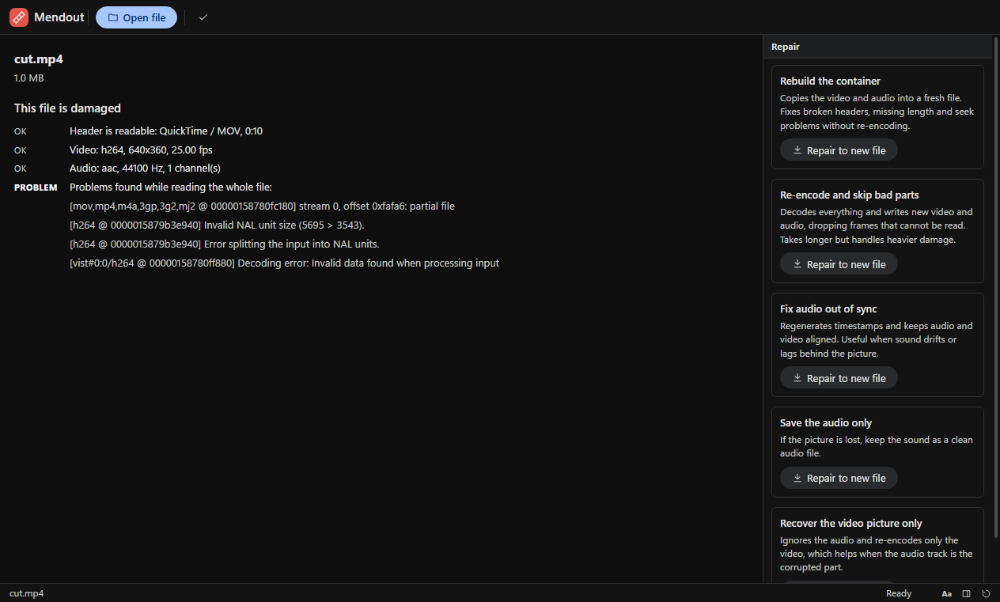
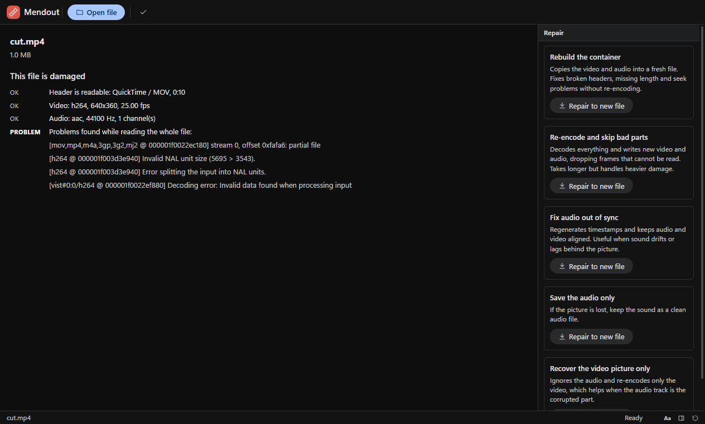
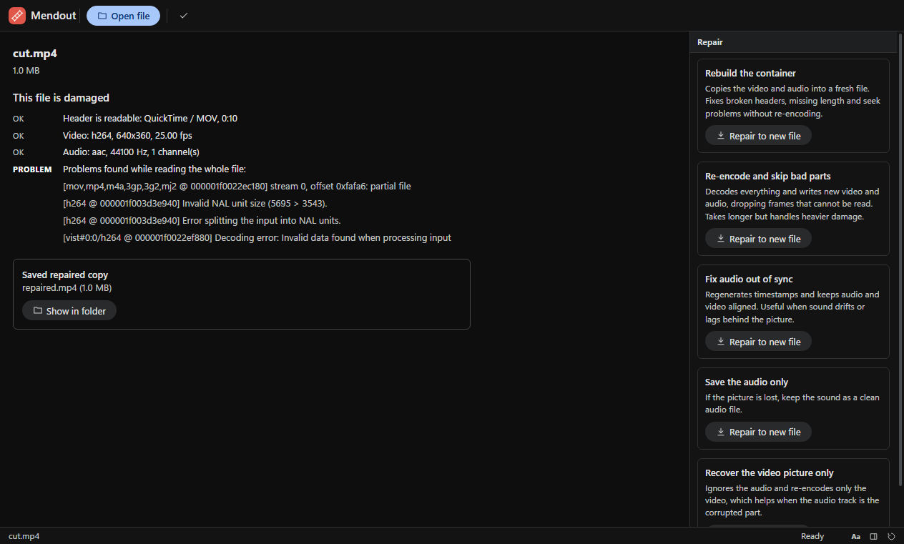
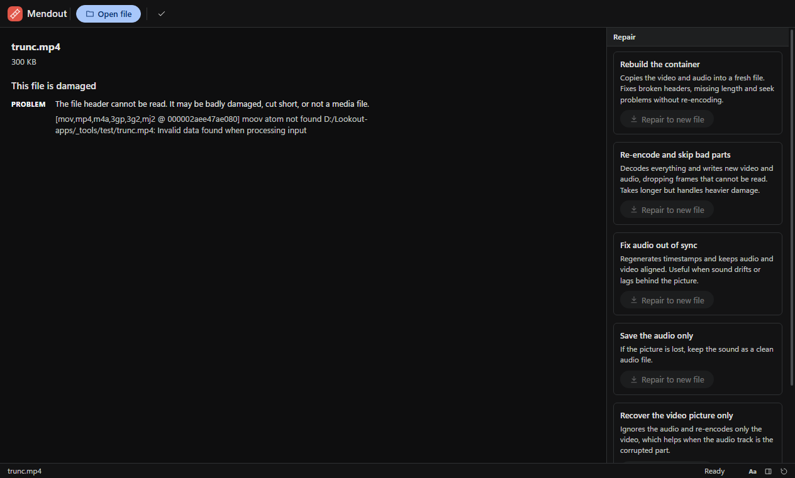

<h1 align="center">Mendout</h1>

<b>Repair damaged media</b> Version 1.0.14 for Windows · Free · Offline · No account

<a href="https://github.com/plawanpawin-byte/mendout/releases/latest"><b>Download Mendout</b></a> · <a href="https://github.com/plawanpawin-byte/lookout-launcher">Lookout launcher</a> · <a href="https://github.com/plawanpawin-byte/Lookout">All Lookout apps</a>

---

Mendout checks a video, audio file, picture or PDF for problems and repairs it into a new file. It explains what it found in plain language and offers fixes that match the damage. Your original file is never touched.

**Made for:** A recording that stopped early, a file that will not seek or play, or audio that drifts away from the picture.

**On this page:** [In plain words](#in-plain-words) · [Who it is for](#who-it-is-for) · [Try it in 3 steps](#try-it-in-3-steps) · [Screenshots](#see-it-in-action) · [Features](#everything-it-can-do) · [How to use it](#how-to-use-it) · [Privacy](#private-by-design) · [Install](#install) · [Questions](#questions)

## In plain words

Mendout is a **repair shop for damaged files**. If a video stops halfway, an audio file will not play, a photo shows only a grey area or a PDF will not open, Mendout looks inside to find what is wrong, tells you in plain language, and offers fixes that fit the damage.

It never changes your original: the repaired version is saved as a **new file** next to it. If the file is too damaged to save, Mendout says so honestly instead of pretending. If it is healthy, it tells you that too.

**Not for:** Mendout repairs structure (missing ends, broken headers). It cannot bring back parts of a recording that were never saved.

## Who it is for

- **Anyone with a video from an interrupted recording** or a half-copied download.
- **Photographers** with a picture that will not open.
- **Office workers** with a PDF that complains it is damaged.

## Try it in 3 steps

1. Click **Open file** and choose the file that does not work, then click **Check file**.
2. Read the report on the right. It lists what it found.
3. Choose a repair, click **Repair to new file**, then **Show in folder** to find it.

## What is new in 1.0.14

A new look inspired by Google's own tools (AI Studio, Colab, Gemini): a calm dark charcoal theme, rounded pill buttons, a soft blue accent and roomier spacing. The app icon is now a colour logo so you can find Mendout at a glance in the Start menu and in the Lookout launcher. All screenshots below were taken again with the new look.

## In plain words

Mendout is a **repair shop for damaged files**. If a video stops halfway, an audio file will not play, a photo shows only a grey area or a PDF will not open, Mendout looks inside to find what is wrong, tells you in plain language, and offers fixes that fit the damage.

It never changes your original: the repaired version is saved as a **new file** next to it. If the file is too damaged to save, Mendout says so honestly instead of pretending. If it is healthy, it tells you that too.

**Not for:** Mendout repairs structure (missing ends, broken headers). It cannot bring back parts of a recording that were never saved.

## Who it is for

- **Anyone with a video from an interrupted recording** or a half-copied download.
- **Photographers** with a picture that will not open.
- **Office workers** with a PDF that complains it is damaged.

## Try it in 3 steps

1. Click **Open file** and choose the file that does not work, then click **Check file**.
2. Read the report on the right. It lists what it found.
3. Choose a repair, click **Repair to new file**, then **Show in folder** to find it.

## See it in action

### Opening a file

Choose a damaged file and Mendout shows its name and size.

### The check report

Mendout reads the whole file and lists what is fine and what is wrong. Here the recording was cut short.

### Repair done

A repaired copy was saved, with a button to show it in its folder.

### A file that cannot be recovered

When the header is unreadable the repair buttons stay off instead of pretending.

### A healthy file

A clean report means nothing needs fixing.

### Output

A frame from the repaired video.

## The interface

- **Top bar:** open a file and check it.
- **Centre:** the report, with each finding marked OK or Problem, followed by the result of a repair.
- **Right panel:** the repair methods, each with a short explanation and its own button.

## Everything it can do

### Check

- Reads the header, video and audio streams
- Decodes the whole file to find hidden errors
- Detects a missing length and files cut short

### Repair

- Rebuild the container without re-encoding
- Re-encode and skip bad parts
- Fix audio out of sync
- Save the audio only
- Recover the video picture only

### Pictures and PDF

- Repair PNG checksums, junk and cut-off ends, and JPEG end markers
- Re-encode a damaged picture as PNG or JPEG
- Rebuild the index of a cut-off PDF so it opens again

### Audio

- Save damaged WAV, FLAC or MP3 as a clean WAV or FLAC

### Safe

- Always writes a new file
- The original is only read

## How to use it

1. Click **Open file**.
2. Click **Check file** to see the report.
3. Choose a repair and click **Repair to new file**.
4. Click **Show in folder** to find the result.

## Files and formats

Video and audio such as MP4, MOV, MKV, AVI, WebM, MP3, WAV and FLAC, pictures (PNG, JPEG) and PDF.

## Private by design

- No account, no sign-in, no subscription, no ads.
- Mendout works offline. It never uses the network.
- Files are opened and saved only through the Windows file dialogs you use. Mendout cannot browse your disk on its own.
- The app window runs in a locked-down sandbox with a strict content policy.

## Install

1. Open the [latest release](https://github.com/plawanpawin-byte/mendout/releases/latest) and download the file named **Mendout-Setup-** followed by the version number and **.exe**. You can also install it from the [Lookout launcher](https://github.com/plawanpawin-byte/lookout-launcher), which keeps it up to date.
2. Run the installer. It installs just for you, so it does not ask for administrator rights.
3. Windows may show a blue **Windows protected your PC** screen because these installers are not signed with a paid certificate. Click **More info**, then **Run anyway**.
4. Open Mendout from the Start menu.

**Requirements:** Windows 10 or 11, 64-bit. About 500 MB of free disk space. No internet connection is needed to use the app.

## Questions

**Can everything be fixed?**  
No. If the beginning of a file is destroyed there may be nothing to rebuild. PDFs that hide their catalog in compressed streams cannot be rebuilt offline. Mendout tells you instead of pretending.

**Why "truncated"?**  
The file ends too early, usually because a recording or copy was interrupted. Mendout can often rebuild the missing end so the rest plays.

**Will it overwrite my file?**  
Never. Repairs go to a new file.

**What if repair fails?**  
The report says the file cannot be recovered and why; nothing is changed.

**Why "truncated"?**  
The file ends too early, usually because a recording or copy was interrupted. Mendout can often rebuild the missing end so the rest plays.

**Will it overwrite my file?**  
Never. Repairs go to a new file.

**What if repair fails?**  
The report says the file cannot be recovered and why; nothing is changed.

## About Lookout

Mendout is part of **[Lookout](https://github.com/plawanpawin-byte/Lookout)**: ten small, private Windows apps for documents and media that share one look and one promise, that your files stay on your computer. Install and update them together with the [Lookout launcher](https://github.com/plawanpawin-byte/lookout-launcher).

| | App | What it is for | Code |
| --- | --- | --- | --- |
|  | **Lookout** | Install, open and update all the apps below | [GitHub](https://github.com/plawanpawin-byte/lookout-launcher) |
|  | **Pageout** | Read, annotate and sign PDFs | [GitHub](https://github.com/plawanpawin-byte/pageout) |
|  | **Chartout** | Flowcharts, org charts and diagrams | [GitHub](https://github.com/plawanpawin-byte/chartout) |
|  | **Branchout** | Mind maps and outlines | [GitHub](https://github.com/plawanpawin-byte/branchout) |
|  | **Planout** | Project plans and Gantt timelines | [GitHub](https://github.com/plawanpawin-byte/planout) |
|  | **Frameout** | App and web screen design with click-through prototypes | [GitHub](https://github.com/plawanpawin-byte/frameout) |
|  | **Cutout** | Video editing on a timeline | [GitHub](https://github.com/plawanpawin-byte/cutout) |
|  | **Shiftout** | Convert and compress video and audio, make GIFs | [GitHub](https://github.com/plawanpawin-byte/shiftout) |
|  | **Castout** | Record your screen | [GitHub](https://github.com/plawanpawin-byte/castout) |
|  | **Mendout** | Check and repair damaged video, audio, pictures and PDFs | [GitHub](https://github.com/plawanpawin-byte/mendout) |
|  | **Tuneout** | Record and edit audio | [GitHub](https://github.com/plawanpawin-byte/tuneout) |

Released under the MIT License.
