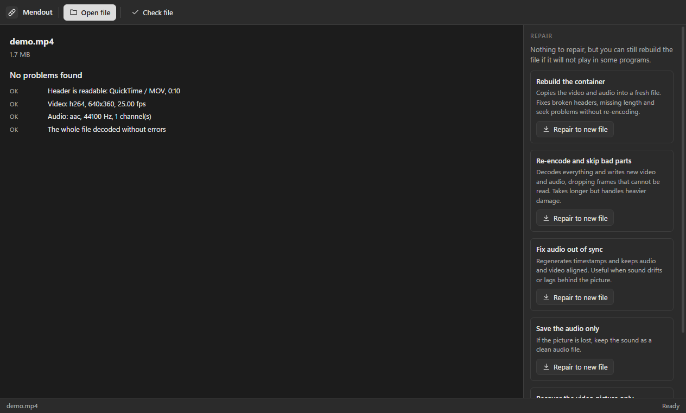

<b>Repair damaged media</b> Version 1.0.2 for Windows · Free · Offline · No account

<a href="https://github.com/plawanpawin-byte/mendout/releases/latest"><b>Download Mendout</b></a> · <a href="https://github.com/plawanpawin-byte/Lookout">All Lookout apps</a>

---

Mendout checks a video or audio file for problems and repairs it into a new file. It explains what it found in plain language and offers fixes that match the damage. Your original file is never touched.

**Made for:** A recording that stopped early, a file that will not seek or play, or audio that drifts away from the picture.

**On this page:** [Screenshots](#see-it-in-action) · [Interface](#the-interface) · [Features](#everything-it-can-do) · [How to use it](#how-to-use-it) · [Formats](#files-and-formats) · [Privacy](#private-by-design) · [Install](#install) · [Questions](#questions)

## What is new in 1.0.2

A refreshed interface: every toolbar button now has a clear line icon, the app's mark sits at the top left, controls share one height and spacing, panels line up in tidy grids, and the toolbar keeps every button reachable on smaller windows by switching less important buttons to icons.

## See it in action

### Opening a file

Choose a damaged file and Mendout shows its name and size.

### The check report

Mendout reads the whole file and lists what is fine and what is wrong. Here the recording was cut short.

### Repair done

A repaired copy was saved, with a button to show it in its folder.

### A file that cannot be recovered

When the header is unreadable the repair buttons stay off instead of pretending.

### A healthy file

A clean report means nothing needs fixing.

### Output

A frame from the repaired video.

## The interface

- **Top bar:** open a file and check it.
- **Centre:** the report, with each finding marked OK or Problem, followed by the result of a repair.
- **Right panel:** the repair methods, each with a short explanation and its own button.

## Everything it can do

### Check

- Reads the header, video and audio streams
- Decodes the whole file to find hidden errors
- Detects a missing length and files cut short

### Repair

- Rebuild the container without re-encoding
- Re-encode and skip bad parts
- Fix audio out of sync
- Save the audio only
- Recover the video picture only

### Safe

- Always writes a new file
- The original is only read

## How to use it

1. Click **Open file**.
2. Click **Check file** to see the report.
3. Choose a repair and click **Repair to new file**.
4. Click **Show in folder** to find the result.

## Files and formats

Common video and audio files such as MP4, MOV, MKV, AVI, WebM, MP3 and WAV.

## Private by design

- No account, no sign-in, no subscription, no ads.
- Mendout works offline. It never uses the network.
- Files are opened and saved only through the Windows file dialogs you use. Mendout cannot browse your disk on its own.
- The app window runs in a locked-down sandbox with a strict content policy.

## Install

1. Open the [latest release](https://github.com/plawanpawin-byte/mendout/releases/latest) and download the file named **Mendout-Setup-** followed by the version number and **.exe**. You can also install it from the [Lookout launcher](https://github.com/${OWNER}/lookout-launcher), which keeps it up to date.
2. Run the installer. It installs just for you, so it does not ask for administrator rights.
3. Windows may show a blue **Windows protected your PC** screen because these installers are not signed with a paid certificate. Click **More info**, then **Run anyway**.
4. Open Mendout from the Start menu.

**Requirements:** Windows 10 or 11, 64-bit. About 500 MB of free disk space. No internet connection is needed to use the app.

## Questions

**Can everything be fixed?**  
No. If the beginning of a file is destroyed there may be nothing to rebuild. Mendout tells you instead of pretending.

## About Lookout

Mendout belongs to the **[Lookout](https://github.com/plawanpawin-byte/Lookout)** family: ten small, private Windows apps for documents and media, all with the same calm grey look and the same promise that your files stay yours. Install and update them together with the [Lookout launcher](https://github.com/plawanpawin-byte/lookout-launcher).

- **[Pageout](https://github.com/plawanpawin-byte/pageout)**: read, annotate and sign pdfs
- **[Chartout](https://github.com/plawanpawin-byte/chartout)**: flowcharts and diagrams
- **[Branchout](https://github.com/plawanpawin-byte/branchout)**: mind maps and outlines
- **[Planout](https://github.com/plawanpawin-byte/planout)**: plans and gantt timelines
- **[Frameout](https://github.com/plawanpawin-byte/frameout)**: screen design and prototypes
- **[Cutout](https://github.com/plawanpawin-byte/cutout)**: video editing on a timeline
- **[Shiftout](https://github.com/plawanpawin-byte/shiftout)**: convert and compress media
- **[Castout](https://github.com/plawanpawin-byte/castout)**: record your screen
- **[Tuneout](https://github.com/plawanpawin-byte/tuneout)**: record and edit audio

Released under the MIT License.
