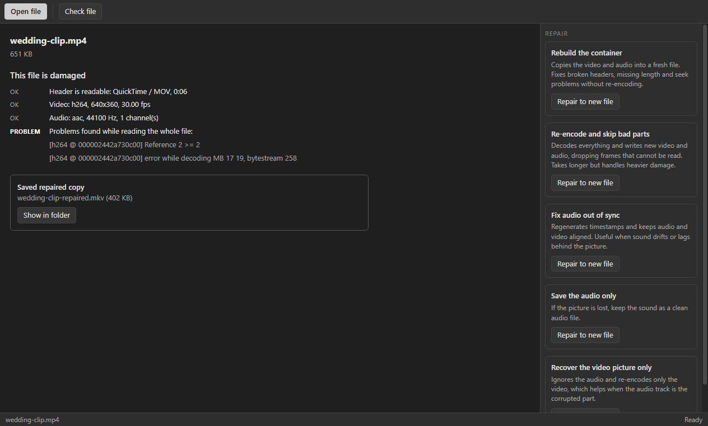

# Mendout

A private repair and health-check tool for damaged video and audio files on Windows. Mendout reads your file, tells you in plain words what is wrong, and saves a repaired copy. Your original is never changed. No account, no subscription and no internet connection needed.

## What you can do

- **Check any video or audio file** for unreadable headers, missing length, missing streams and decoding errors
- **Rebuild the container** to fix files that will not open, will not seek or show the wrong length
- **Re-encode and skip bad parts** for files with damaged sections
- **Fix audio out of sync**
- **Save the audio only** when the picture is lost
- **Recover the picture only** when the sound track is the broken part
- Works with MP4, MKV, MOV, AVI, WebM, MP3, WAV, FLAC and more

Repair always saves to a new file, so you can try several methods safely. Files that are cut off so badly that no header survives may not be recoverable.

## Your files stay on your computer

Mendout works entirely offline. There is no account, no upload and no tracking.

## Download

Get **Mendout-Setup-1.0.0.exe** from the [Releases](../../releases/latest) page and run it.

Part of the [Lookout](https://github.com/plawanpawin-byte/Lookout) family of apps.

Released under the MIT License. Media processing uses FFmpeg, which is licensed under the GNU GPL.
